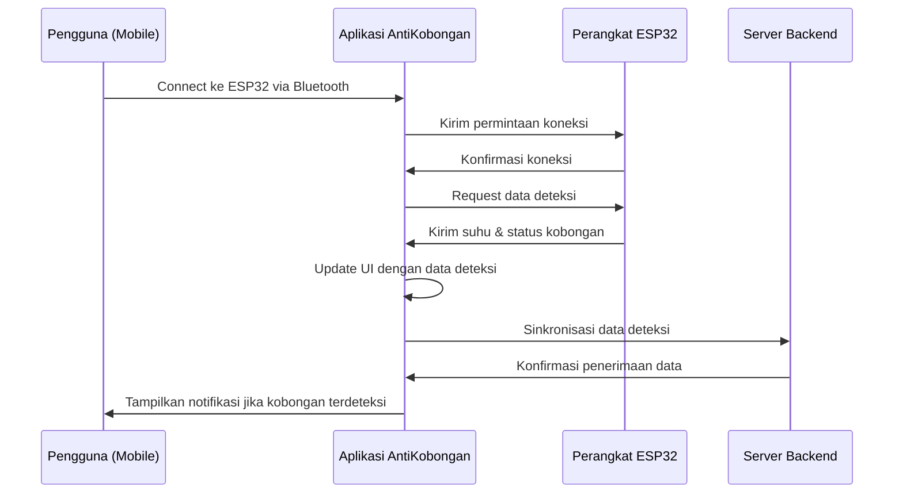
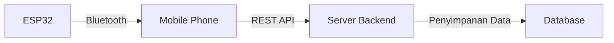

# AntiKobongan


> Aplikasi IoT berbasis mobile untuk mendeteksi kobongan saat memasak secara real-time menggunakan ESP32 dan konektivitas Bluetooth.

[](README.md)
[](README.id.md)

---

## Daftar Isi

- [Overview](#overview)
- [Fitur](#fitur)
- [Tech Stack](#tech-stack)
- [Arsitektur](#arsitektur)
- [Prasyarat](#prasyarat)
- [Instalasi](#instalasi)
- [Penggunaan](#penggunaan)
- [Konfigurasi](#konfigurasi)
- [Struktur Proyek](#struktur-proyek)
- [Dokumentasi API](#dokumentasi-api)
- [Deployment](#deployment)
- [Kontribusi](#kontribusi)
- [License](#license)
- [Kontak](#kontak)

---

## Overview

AntiKobongan adalah aplikasi IoT berbasis mobile yang dirancang untuk mendeteksi kobongan saat memasak secara real-time. Aplikasi ini bekerja dengan bantuan ESP32 yang terhubung melalui Bluetooth ke HP pengguna. Sistem ini memberikan notifikasi langsung jika terdeteksi kobongan pada panganan yang sedang dimasak, membantu pengguna mencegah kebakaran dan kerusakan makanan.

### Masalah yang Diselesaikan

- **Kesalahan memasak:** Mendeteksi kobongan sebelum terjadi kebakaran
- **Kenyamanan:** Monitoring real-time tanpa harus memantau langsung
- **Keamanan:** Notifikasi cepat untuk mencegah kebakaran
- **Efisiensi:** Hemat energi dengan konsumsi daya rendah

---

## Fitur

### Fitur Utama

- ✅ **Deteksi Real-time:** Mendeteksi kobongan secara langsung
- ✅ **Aplikasi Mobile:** Kompatibel dengan Android dan iOS
- ✅ **Konektivitas ESP32:** Konektivitas Bluetooth yang stabil
- ✅ **Tampilan Ramah Pengguna:** Tampilan sederhana dan mudah digunakan
- ✅ **Hemat Daya:** Hemat daya untuk penggunaan jangka panjang
- ✅ **Dukungan Dwi Bahasa:** Mendukung Bahasa Indonesia dan Inggris
- ✅ **Pengaturan Kustom:** Pengaturan sensitivitas dan notifikasi

### Fitur Teknis

- ✅ **Arsitektur Modular:** Struktur kode yang terorganisir
- ✅ **Keamanan Tipe:** TypeScript untuk kode yang lebih aman
- ✅ **RESTful API:** Endpoint untuk komunikasi ESP32
- ✅ **Penanganan Error:** Manajemen error yang baik
- ✅ **CI/CD:** Automated testing dan deployment

---

## Tech Stack

### Frontend
- **React Native:** Framework aplikasi mobile
- **TypeScript:** Type-safe JavaScript
- **React Hooks:** State management dan side effects

### Backend
- **Node.js:** Runtime JavaScript
- **Express:** Web framework
- **TypeScript:** Type safety di sisi server

### Hardware & Communication
- **ESP32:** Microcontroller untuk IoT
- **Arduino:** Pengembangan firmware
- **Bluetooth:** Protocol komunikasi

### Development Tools
- **ESLint:** Code linting
- **Jest:** Testing framework
- **TypeScript:** Type checking

---

## Arsitektur

### Alur Sistem



### Setup Hardware



---

## Prasyarat

Sebelum memulai, pastikan Anda sudah menginstal:

- **Node.js:** v18 atau lebih tinggi
- **npm:** v9 atau lebih tinggi
- **Android Studio:** Untuk pengembangan Android (opsional)
- **Xcode:** Untuk pengembangan iOS (opsional)
- **ESP32 Toolchain:** Untuk pengembangan firmware
- **Bluetooth:** Diaktifkan di perangkat mobile

---

## Instalasi

### Clone Repository

```bash
git clone https://github.com/Ghivee/antikobongan.git
cd antikobongan
```

### Install Dependencies

```bash
npm install
```

### Setup Environment Variables

```bash
cp .env.example .env
# Edit .env dengan nilai-nilai Anda
```

### Build Proyek

```bash
npm run build
```

### Jalankan Server

```bash
npm start
```

Server akan berjalan di `http://localhost:3000`

---

## Penggunaan

### Untuk Pengembangan Aplikasi Mobile

1. **Connect ESP32 ke komputer Anda**
2. **Upload firmware ke ESP32** menggunakan Arduino IDE
3. **Enable Bluetooth** di perangkat mobile Anda
4. **Buka aplikasi** dan connect ke ESP32
5. **Mulai memasak** dan monitoring deteksi secara real-time

### Untuk Pengembangan Backend

1. **Jalankan server:** `npm start`
2. **Akses endpoint API:**
   - Health check: `GET /health`
   - Get detection: `GET /api/detection`
   - Update detection: `POST /api/detection`
   - Connect device: `POST /api/device/connect`

### Contoh Penggunaan

```javascript
// Connect ke ESP32
const response = await fetch('http://localhost:3000/api/device/connect', {
  method: 'POST',
  headers: { 'Content-Type': 'application/json' },
  body: JSON.stringify({ deviceId: 'ESP32-12345' })
});

// Get data deteksi
const detection = await fetch('http://localhost:3000/api/detection')
  .then(res => res.json());

console.log('Suhu:', detection.temperature);
console.log('Status Kobongan:', detection.burningSensation);
```

---

## Konfigurasi

### Environment Variables

| Variabel | Deskripsi | Default | Required |
|----------|-----------|---------|----------|
| `PORT` | Port server | `3000` | No |
| `ESP32_BAUD_RATE` | Baud rate ESP32 | `9600` | No |
| `ESP32_BLE_DEVICE_NAME` | Nama device BLE ESP32 | `AntiKobongan` | No |
| `APP_NAME` | Nama aplikasi | `AntiKobongan` | No |
| `APP_VERSION` | Versi aplikasi | `1.0.0` | No |
| `DEBUG` | Enable debug logging | `false` | No |
| `LOG_LEVEL` | Level logging | `info` | No |

### Contoh File Konfigurasi

```bash
# .env file
PORT=3000
ESP32_BAUD_RATE=9600
ESP32_BLE_DEVICE_NAME="AntiKobongan"
APP_NAME="AntiKobongan"
APP_VERSION="1.0.0"
DEBUG=false
LOG_LEVEL=info
```

---

## Struktur Proyek

```
antikobongan/
├── src/
│   ├── app.tsx                 # Entry point aplikasi utama
│   ├── server.ts               # Server Express
│   ├── components/             # Komponen React
│   │   ├── Header.tsx
│   │   ├── DetectionCard.tsx
│   │   └── Settings.tsx
│   ├── screens/                # Layar React Native
│   │   └── HomeScreen.tsx
│   ├── services/               # Logika bisnis
│   │   └── BluetoothService.ts
│   ├── hooks/                  # Custom React hooks
│   │   └── useBluetooth.ts
│   ├── types/                  # TypeScript types
│   │   └── index.ts
│   └── utils/                  # Utility functions
│       └── format.ts
├── assets/
│   ├── images/                 # File gambar
│   └── icons/                  # File icon
├── docs/                       # Dokumentasi
│   ├── api.md                  # Dokumentasi API
│   └── hardware.md             # Panduan setup hardware
├── tests/                      # File test
│   └── (unit tests)
├── .github/
│   └── workflows/
│       └── ci.yml              # Workflow CI/CD
├── .env.example                # Template environment variables
├── .gitignore                  # Git ignore rules
├── LICENSE                     # License MIT
├── README.md                   # File ini
├── README.id.md                # Versi Indonesia
├── CHANGELOG.md                # Changelog
├── package.json                # Dependensi proyek
├── tsconfig.json               # Konfigurasi TypeScript
└── vercel.json                 # Konfigurasi deployment Vercel
```

---

## Dokumentasi API

### Base URL

```
http://localhost:3000
```

### Endpoints

#### Health Check

```http
GET /health
```

**Response:**

```json
{
  "status": "ok",
  "timestamp": "2026-11-22T15:00:00.000Z",
  "version": "1.0.0"
}
```

#### Get Data Deteksi

```http
GET /api/detection
```

**Response:**

```json
{
  "temperature": 37.5,
  "burningSensation": false,
  "timestamp": 1700698800000
}
```

#### Update Data Deteksi

```http
POST /api/detection
Content-Type: application/json

{
  "temperature": 95,
  "burningSensation": true
}
```

**Response:**

```json
{
  "success": true,
  "message": "Detection data received",
  "data": {
    "temperature": 95,
    "burningSensation": true,
    "timestamp": 1700698800000
  }
}
```

#### Connect Device

```http
POST /api/device/connect
Content-Type: application/json

{
  "deviceId": "ESP32-12345"
}
```

**Response:**

```json
{
  "success": true,
  "message": "Device connected",
  "deviceId": "ESP32-12345"
}
```

---

## Deployment

### Opsi 1: Vercel (Disarankan)

**Mengapa Vercel?**
- Gratis untuk proyek pribadi
- Deployment otomatis dari GitHub
- Performa ekcelent
- CDN global
- Setup mudah

**Langkah-langkah:**

1. **Push ke GitHub:**
```bash
git add .
git commit -m "docs: add comprehensive bilingual documentation"
git push origin main
```

2. **Connect ke Vercel:**
   - Buka [vercel.com](https://vercel.com)
   - Import repository GitHub Anda
   - Vercel akan otomatis mendeteksi konfigurasi

3. **Deploy:**
   - Vercel akan build dan deploy otomatis
   - Dapatkan URL live Anda dalam hitungan menit

4. **Environment Variables:**
   - Buka Dashboard Vercel
   - Tambah environment variables dari `.env.example`

### Opsi 2: Netlify

**Mengapa Netlify?**
- Mirip dengan Vercel
- Bagus untuk situs statis
- Gratis untuk proyek pribadi

**Langkah-langkah:**

1. **Build configuration:**
```bash
npm run build
```

2. **Deploy ke Netlify:**
   - Drag and drop folder `dist` ke Netlify
   - Atau connect via GitHub integration

3. **Configure:**
   - Set build command: `npm run build`
   - Set publish directory: `dist`

### Opsi 3: Docker

**Mengapa Docker?**
- Deployment konsisten
- Containerization mudah
- Production-ready

**Langkah-langkah:**

1. **Create `Dockerfile`:**
```dockerfile
FROM node:18-alpine
WORKDIR /app
COPY package*.json ./
RUN npm ci --only=production
COPY . .
EXPOSE 3000
CMD ["npm", "start"]
```

2. **Build image:**
```bash
docker build -t antikobongan:latest .
```

3. **Run container:**
```bash
docker run -p 3000:3000 antikobongan:latest
```

---

## Kontribusi

Kami menerima kontribusi! Silakan ikuti langkah-langkah berikut:

1. Fork repository
2. Create branch feature (`git checkout -b feature/AmazingFeature`)
3. Commit perubahan Anda (`git commit -m 'feat: add AmazingFeature'`)
4. Push ke branch (`git push origin feature/AmazingFeature`)
5. Buka Pull Request

### Konvensi Commit

Kami menggunakan [Conventional Commits](https://www.conventionalcommits.org/):

- `feat:` Fitur baru
- `fix:` Perbaikan bug
- `docs:` Hanya dokumentasi
- `style:` Perubahan gaya kode (formatting, dll)
- `refactor:` Refactoring kode
- `test:` Menambah atau update test
- `chore`: Maintenance tasks

---

## License

Proyek ini dilisensikan di bawah License MIT - lihat file [LICENSE](LICENSE) untuk detail.

---

## Kontak

**Galang Ahmad Ghifari**

- **GitHub:** https://github.com/Ghivee
- **Website:** https://ghifariahmad212.github.io
- **Email:** ghifariahmad212@gmail.com

---

## Acknowledgments

- ESP32 development community
- React Native community
- Open source contributors

---

**Dibuat dengan ❤️ oleh Galang Ahmad Ghifari**
