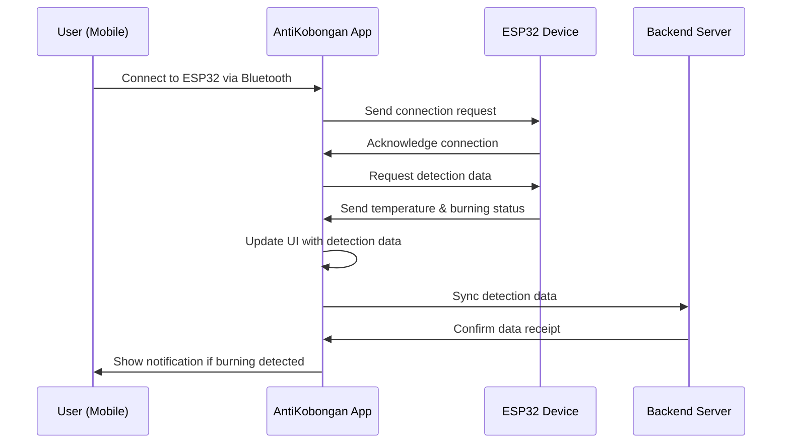
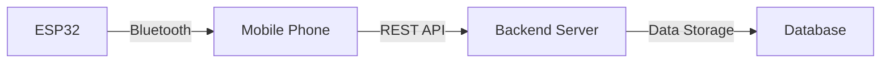

# AntiKobongan


> IoT-based mobile application to detect cooking burning sensation in real-time using ESP32 and Bluetooth connectivity.

[](README.md)
[](README.id.md)

---

## Table of Contents

- [Overview](#overview)
- [Features](#features)
- [Tech Stack](#tech-stack)
- [Architecture](#architecture)
- [Prerequisites](#prerequisites)
- [Installation](#installation)
- [Usage](#usage)
- [Configuration](#configuration)
- [Project Structure](#project-structure)
- [API Documentation](#api-documentation)
- [Deployment](#deployment)
- [Contributing](#contributing)
- [License](#license)
- [Contact](#contact)

---

## Overview

AntiKobongan adalah aplikasi IoT berbasis mobile yang dirancang untuk mendeteksi kobongan saat memasak secara real-time. Aplikasi ini bekerja dengan bantuan ESP32 yang terhubung melalui Bluetooth ke HP pengguna. Sistem ini memberikan notifikasi langsung jika terdeteksi kobongan pada panganan yang sedang dimasak, membantu pengguna mencegah kebakaran dan kerusakan makanan.

### Masalah yang Diselesaikan

- **Kesalahan memasak:** Mendeteksi kobongan sebelum terjadi kebakaran
- **Kenyamanan:** Monitoring real-time tanpa harus memantau langsung
- **Keamanan:** Notifikasi cepat untuk mencegah kebakaran
- **Efisiensi:** Hemat energi dengan konsumsi daya rendah

---

## Features

### Core Features

- ✅ **Real-time Detection**: Mendeteksi kobongan secara langsung
- ✅ **Mobile App**: Kompatibel dengan Android dan iOS
- ✅ **ESP32 Connectivity**: Konektivitas Bluetooth yang stabil
- ✅ **User-friendly Interface**: Tampilan sederhana dan mudah digunakan
- ✅ **Low Power Consumption**: Hemat daya untuk penggunaan jangka panjang
- ✅ **Bilingual Support**: Mendukung Bahasa Indonesia dan Inggris
- ✅ **Customizable Settings**: Pengaturan sensitivitas dan notifikasi

### Technical Features

- ✅ **Modular Architecture**: Struktur kode yang terorganisir
- ✅ **Type Safety**: TypeScript untuk kode yang lebih aman
- ✅ **RESTful API**: Endpoint untuk komunikasi ESP32
- ✅ **Error Handling**: Manajemen error yang baik
- ✅ **CI/CD**: Automated testing dan deployment

---

## Tech Stack

### Frontend
- **React Native**: Mobile app framework
- **TypeScript**: Type-safe JavaScript
- **React Hooks**: State management dan side effects

### Backend
- **Node.js**: JavaScript runtime
- **Express**: Web framework
- **TypeScript**: Server-side type safety

### Hardware & Communication
- **ESP32**: Microcontroller for IoT
- **Arduino**: Firmware development
- **Bluetooth**: Communication protocol

### Development Tools
- **ESLint**: Code linting
- **Jest**: Testing framework
- **TypeScript**: Type checking

---

## Architecture

### System Flow



### Hardware Setup



---

## Prerequisites

Before you begin, ensure you have the following installed:

- **Node.js**: v18 or higher
- **npm**: v9 or higher
- **Android Studio**: For Android development (optional)
- **Xcode**: For iOS development (optional)
- **ESP32 Toolchain**: For firmware development
- **Bluetooth**: Enabled on mobile device

---

## Installation

### Clone the Repository

```bash
git clone https://github.com/Ghivee/antikobongan.git
cd antikobongan
```

### Install Dependencies

```bash
npm install
```

### Setup Environment Variables

```bash
cp .env.example .env
# Edit .env with your values
```

### Build the Project

```bash
npm run build
```

### Run the Server

```bash
npm start
```

The server will start on `http://localhost:3000`

---

## Usage

### For Mobile App Development

1. **Connect ESP32 to your computer**
2. **Upload firmware to ESP32** using Arduino IDE
3. **Enable Bluetooth** on your mobile device
4. **Open the app** and connect to ESP32
5. **Start cooking** and monitor detection in real-time

### For Backend Development

1. **Start the server**: `npm start`
2. **Access API endpoints**:
   - Health check: `GET /health`
   - Get detection: `GET /api/detection`
   - Update detection: `POST /api/detection`
   - Connect device: `POST /api/device/connect`

### Example Usage

```javascript
// Connect to ESP32
const response = await fetch('http://localhost:3000/api/device/connect', {
  method: 'POST',
  headers: { 'Content-Type': 'application/json' },
  body: JSON.stringify({ deviceId: 'ESP32-12345' })
});

// Get detection data
const detection = await fetch('http://localhost:3000/api/detection')
  .then(res => res.json());

console.log('Temperature:', detection.temperature);
console.log('Burning Sensation:', detection.burningSensation);
```

---

## Configuration

### Environment Variables

| Variable | Description | Default | Required |
|----------|-------------|---------|----------|
| `PORT` | Server port | `3000` | No |
| `ESP32_BAUD_RATE` | ESP32 baud rate | `9600` | No |
| `ESP32_BLE_DEVICE_NAME` | ESP32 BLE device name | `AntiKobongan` | No |
| `APP_NAME` | Application name | `AntiKobongan` | No |
| `APP_VERSION` | Application version | `1.0.0` | No |
| `DEBUG` | Enable debug logging | `false` | No |
| `LOG_LEVEL` | Logging level | `info` | No |

### Configuration File Example

```bash
# .env file
PORT=3000
ESP32_BAUD_RATE=9600
ESP32_BLE_DEVICE_NAME="AntiKobongan"
APP_NAME="AntiKobongan"
APP_VERSION="1.0.0"
DEBUG=false
LOG_LEVEL=info
```

---

## Project Structure

```
antikobongan/
├── src/
│   ├── app.tsx                 # Main app entry point
│   ├── server.ts               # Express server
│   ├── components/             # React components
│   │   ├── Header.tsx
│   │   ├── DetectionCard.tsx
│   │   └── Settings.tsx
│   ├── screens/                # React Native screens
│   │   └── HomeScreen.tsx
│   ├── services/               # Business logic
│   │   └── BluetoothService.ts
│   ├── hooks/                  # Custom React hooks
│   │   └── useBluetooth.ts
│   ├── types/                  # TypeScript types
│   │   └── index.ts
│   └── utils/                  # Utility functions
│       └── format.ts
├── assets/
│   ├── images/                 # Image files
│   └── icons/                  # Icon files
├── docs/                       # Documentation
│   ├── api.md                  # API documentation
│   └── hardware.md             # Hardware setup guide
├── tests/                      # Test files
│   └── (unit tests)
├── .github/
│   └── workflows/
│       └── ci.yml              # CI/CD workflow
├── .env.example                # Environment variables template
├── .gitignore                  # Git ignore rules
├── LICENSE                     # MIT License
├── README.md                   # This file
├── README.id.md                # Indonesian version
├── CHANGELOG.md                # Changelog
├── package.json                # Project dependencies
├── tsconfig.json               # TypeScript configuration
└── vercel.json                 # Vercel deployment config
```

---

## API Documentation

### Base URL

```
http://localhost:3000
```

### Endpoints

#### Health Check

```http
GET /health
```

**Response:**

```json
{
  "status": "ok",
  "timestamp": "2026-11-22T15:00:00.000Z",
  "version": "1.0.0"
}
```

#### Get Detection Data

```http
GET /api/detection
```

**Response:**

```json
{
  "temperature": 37.5,
  "burningSensation": false,
  "timestamp": 1700698800000
}
```

#### Update Detection Data

```http
POST /api/detection
Content-Type: application/json

{
  "temperature": 95,
  "burningSensation": true
}
```

**Response:**

```json
{
  "success": true,
  "message": "Detection data received",
  "data": {
    "temperature": 95,
    "burningSensation": true,
    "timestamp": 1700698800000
  }
}
```

#### Connect Device

```http
POST /api/device/connect
Content-Type: application/json

{
  "deviceId": "ESP32-12345"
}
```

**Response:**

```json
{
  "success": true,
  "message": "Device connected",
  "deviceId": "ESP32-12345"
}
```

---

## Deployment

### Option 1: Vercel (Recommended)

**Why Vercel?**
- Free for personal projects
- Automatic deployments from GitHub
- Excellent performance
- Global CDN
- Easy setup

**Steps:**

1. **Push to GitHub:**
```bash
git add .
git commit -m "docs: add comprehensive bilingual documentation"
git push origin main
```

2. **Connect to Vercel:**
   - Go to [vercel.com](https://vercel.com)
   - Import your GitHub repository
   - Vercel will automatically detect the config

3. **Deploy:**
   - Vercel will build and deploy automatically
   - Get your live URL in minutes

4. **Environment Variables:**
   - Go to Vercel Dashboard
   - Add environment variables from `.env.example`

### Option 2: Netlify

**Why Netlify?**
- Similar to Vercel
- Good for static sites
- Free for personal projects

**Steps:**

1. **Build configuration:**
```bash
npm run build
```

2. **Deploy to Netlify:**
   - Drag and drop `dist` folder to Netlify
   - Or connect via GitHub integration

3. **Configure:**
   - Set build command: `npm run build`
   - Set publish directory: `dist`

### Option 3: Docker

**Why Docker?**
- Consistent deployment
- Easy containerization
- Production-ready

**Steps:**

1. **Create `Dockerfile`:**
```dockerfile
FROM node:18-alpine
WORKDIR /app
COPY package*.json ./
RUN npm ci --only=production
COPY . .
EXPOSE 3000
CMD ["npm", "start"]
```

2. **Build image:**
```bash
docker build -t antikobongan:latest .
```

3. **Run container:**
```bash
docker run -p 3000:3000 antikobongan:latest
```

---

## Contributing

We welcome contributions! Please follow these steps:

1. Fork the repository
2. Create a feature branch (`git checkout -b feature/AmazingFeature`)
3. Commit your changes (`git commit -m 'feat: add AmazingFeature'`)
4. Push to the branch (`git push origin feature/AmazingFeature`)
5. Open a Pull Request

### Commit Convention

We use [Conventional Commits](https://www.conventionalcommits.org/):

- `feat:` New feature
- `fix:` Bug fix
- `docs:` Documentation only
- `style:` Code style changes (formatting, etc.)
- `refactor:` Code refactoring
- `test:` Adding or updating tests
- `chore:` Maintenance tasks

---

## License

This project is licensed under the MIT License - see the [LICENSE](LICENSE) file for details.

---

## Contact

**Galang Ahmad Ghifari**

- **GitHub:** https://github.com/Ghivee
- **Website:** https://ghifariahmad212.github.io
- **Email:** ghifariahmad212@gmail.com

---

## Acknowledgments

- ESP32 development community
- React Native community
- Open source contributors

---

**Made with ❤️ by Galang Ahmad Ghifari**
